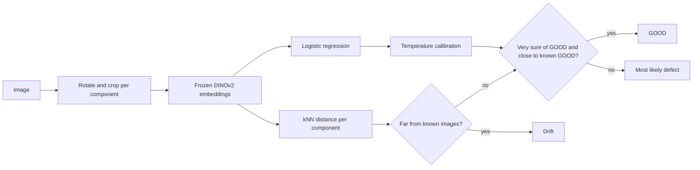

# Valeo visual quality control

Image classification and out-of-domain detection on a production line, for [ENS Challenge Data n°157](https://challengedata.ens.fr/challenges/157) by Valeo.

- **Model:** logistic regression on frozen DINOv2 embeddings, a kNN drift detector per component, and a decision rule that minimises the cost of errors.
- **Result:** public score of [SCORE], against 0.9860 for a constant prediction and 0.9755 for the notebook benchmark, computed on the whole test set.
- **Rigour:** the official metric was identified with two probe submissions, because the challenge page and the supplied notebook disagree. Drift detection is evaluated without a single labelled drift image.
- **Reproducibility:** one command from the images to the submission file, on a MacBook Air M1 with 8 GB of RAM.

## Architecture



## Results

| Prediction | Public score | Mean penalty per image | Source |
|---|---:|---:|---|
| Notebook benchmark | 0.9755 | 245 | Supplied notebook, on all 1,055 test images |
| All Drift | 0.8089 | 1,911 | Probe submission |
| All Missing | 0.9860 | 140 | Probe submission |
| Pipeline, never GOOD | [SCORE] | [SCORE] | `run_pipeline.py --no-good` |
| Pipeline, GOOD when very sure | [SCORE] | [SCORE] | `run_pipeline.py --good` |

Public scores cover 528 images, about half of the test set, so the benchmark line is only indicative.

## Problem

Valeo inspects components on a production line. Flagged parts are often re-inspected by humans, and a model must also recognise images that fall outside the known domain, where classification is unreliable.

Each image gets one of seven labels: GOOD, five defect classes, or Drift. Drift gathers image capture anomalies, such as blur, and rare defects. **The train set contains no drift image.**

## Data

| | Train | Test |
|---|---:|---:|
| Images | 8,278 | 1,055 |
| Labels | 6 classes | Hidden, 7 classes |

| Class | Train images | Share |
|---|---:|---:|
| Missing | 6,472 | 78.18% |
| GOOD | 1,235 | 14.92% |
| Lift-off blanc | 270 | 3.26% |
| Short circuit MOS | 126 | 1.52% |
| Lift-off noir | 104 | 1.26% |
| Boucle plate | 71 | 0.86% |

Images are 8-bit greyscale PNG files from 4 components (`lib`) and 2 inspection zones (`window`). Each component has its own orientation and scale. Some component and defect pairs have 2 or 3 examples. 21 images are magnified by about 1.85.

No challenge image is published here: the data is available to registered participants only.

## Metric

The score is `1 - mean penalty / 10000`, with one penalty per pair of true and predicted labels. The challenge page and the supplied notebook give different matrices:

| True → predicted | Page | Notebook |
|---|---:|---:|
| GOOD → defect | 100 | 100 |
| Defect → GOOD | 10,000 | 10,000 |
| Drift → GOOD | 10,000 | 10,000 |
| Drift → defect | 1,000 | 1,000 |
| Defect → other defect | 1 | 1 |
| **GOOD → Drift** | **100** | **10,000** |
| **Defect → Drift** | **1** | **1,000** |

**Probe submissions.** Predicting Drift everywhere would score about 0.998 under the page matrix and 0.77 to 0.82 under the notebook matrix. It scored 0.8089, so the leaderboard uses the notebook matrix.

The two probe scores also reveal what is evaluated. Total penalties are whole numbers for only one possible number of images, and only one integer composition reproduces both scores:

| Class | Images | Share | All Missing penalty per image |
|---|---:|---:|---:|
| Drift | 68 | 12.9% | 128.8 |
| GOOD | 61 | 11.6% | 11.6 |
| Missing | 374 | 70.8% | 0 |
| Other defects | 25 | 4.7% | 0.05 |

This changed the plan: undetected drift accounts for 92% of the penalty of a constant prediction, so the detector came before any fine-tuning. These shares come from the leaderboard: the code that produces predictions does not read them, but they did guide the choice of operating points (see [Limits](#limits-and-next-steps)).

## Baselines

The train set has no drift image, so these scores cover the six known classes only and cannot be compared with leaderboard scores.

| Prediction | Mean penalty | PWA | False GOOD rate | GOOD recall |
|---|---:|---:|---:|---:|
| All Missing | 15.0 | 0.9985 | 0.00% | 0.0% |
| Logistic regression, argmax | 21.8 | 0.9978 | 0.26% | 99.5% |
| Logistic regression, minimum cost | 4.2 | 0.9996 | 0.03% | 88.3% |

With argmax, a model with a log loss of 0.031 does worse than a constant. Accounting for the cost of errors divides the penalty by 5.

**Embeddings.** Frozen DINOv2 ViT-S/14, 768 dimensions per view: the class token and the mean of the patch tokens. Each image gives a crop view and a full view. The cache takes 34 MB in float16 and extraction takes about 15 minutes on the M1.

**Preprocessing.** Each image is rotated to a common orientation and cropped, per component. Oversized images are first scaled by 0.54 and centred:

| Component | Oversized images | Fixed crop | Resize to base size | Scale and centre |
|---|---:|---:|---:|---:|
| Die02 | 12 | -0.129 | 0.377 | 0.616 |
| Die03 | 7 | 0.029 | 0.583 | 0.668 |
| Die04 | 2 | 0.082 | 0.227 | 0.227 |

The table gives the median correlation with the same defects at the base scale.

## Validation

5-fold out-of-fold predictions, stratified on label and component. Rare cells fall back on the label alone.

Keeping near-duplicates in the same fold moves the penalty from 4.17 to between 4.26 and 4.29. These groups hold at most 4.4% of the rare defects, so this check says little about them.

## Drift detection

No labelled drift exists in the train set, so pseudo-drift replaces it: each rare defect removed from training, and 500 blurred train images. Models that score a blurred image never saw its source.

**Measured first:** without a detector, the classifier sends pseudo-drift to GOOD, even with the minimum-cost rule.

| Pseudo-drift | Declared GOOD |
|---|---:|
| Short circuit MOS | 51.6% |
| Blur | 27.0% |
| Lift-off noir | 8.7% |
| Lift-off blanc | 1.1% |
| Boucle plate | 0.0% |

**Detector.** The score is the mean cosine distance to the 5 nearest train images of the same component, on the crop embedding. Each component has a threshold that flags 0.5% of known images.

| Pseudo-drift | kNN AUROC | Mahalanobis AUROC | Recall at 0.5% false alarms |
|---|---:|---:|---:|
| Blur | 0.989 | 0.984 | 61.2% |
| Lift-off blanc | 0.985 | 0.982 | 17.4% |
| Lift-off noir | 0.980 | 0.965 | 9.6% |
| Boucle plate | 0.946 | 0.922 | 33.8% |
| Short circuit MOS | 0.919 | 0.876 | 0.0% |

The detector flags 73 of the 1,055 test images (6.9%).

## Decision rule

Probabilities are calibrated with one temperature (T = 1.16), fitted on out-of-fold predictions. An image is labelled:

1. **Drift** if its kNN distance exceeds the threshold of its component.
2. **GOOD** if P(GOOD) exceeds the minimum-cost threshold of about 0.99, and it lies among the closest 25% of known GOOD images of its component.
3. **Otherwise**, the most likely defect.

Declaring GOOD can save at most 11.6 penalty points per image, while each drift image declared GOOD costs 10,000 instead of 1,000. If only 1.2% of the drift passes as GOOD, the gain is gone. The classifier threshold alone is therefore not enough: it assumes reliable probabilities, and the classifier has never seen drift.

| Proximity filter | GOOD recall | Pseudo-drift declared GOOD | Expected gain | Expected loss |
|---:|---:|---:|---:|---:|
| None | 80.6% | 9.0% | 9.3 | 106.7 |
| Closest 75% | 64.0% | 2.4% | 7.4 | 27.6 |
| Closest 50% | 44.0% | 1.1% | 5.1 | 12.9 |
| **Closest 25%** | 22.3% | 0.2% | 2.6 | 1.8 |

Gain and loss are in penalty points per image, using the shares read from the leaderboard. The share declared GOOD is the plain mean over pseudo-drift types, because the mix of real drift is unknown.

[SCORE: comparison of the two submissions, and decision to keep or remove GOOD predictions.]

## What didn't work

- **The notebook crop on oversized images.** Its fixed pixel box misses the component on the 21 magnified images, with a median correlation of -0.129 on Die02. Resizing them to the base size only reaches 0.377, because their magnification does not depend on their size.
- **Argmax.** It scores below a constant prediction under this metric (penalty of 21.8 against 15.0).
- **Trusting P(GOOD) > 0.99 alone.** Without the proximity filter, 40.5% of held-out Short circuit MOS are still declared GOOD after the detector. These defects resemble GOOD images.
- **Mahalanobis on PCA components.** kNN has a better AUROC on all five pseudo-drift types.
- **Adding the full view to the detector.** It does not help at low false alarm rates, and it lowers recall on blur (18.2% against 61.2% at 0.5% false alarms). The classifier does keep both views: log loss of 0.0306 against 0.0327 for the crop alone.
- **Pixel-based near-duplicate search.** It groups 74.7% of the images at a cosine similarity of 0.995, because images of a component share the same layout. It cannot tell two views of one part from two similar parts.
- **Trusting the challenge page.** The page matrix was my first default, and the first probe submission disproved it.

## Reproduce

```bash
uv sync --group train
# place the challenge files in data/raw/
uv run python scripts/run_pipeline.py --good   # or --no-good, the default
```

This extracts the embeddings if they are not cached, fits the classifier and the detector, and writes a validated file in `submissions/`. From an empty cache, it takes about 17 minutes of compute on the M1. Two runs on this machine gave identical embeddings and an identical file.

The analyses behind this README:

```bash
uv run python scripts/alignment_report.py       # oversized images
uv run python scripts/run_baseline.py           # baselines, tracked in MLflow
uv run python scripts/grouped_folds_check.py    # near-duplicates across folds
uv run python scripts/extract_embeddings.py --blur
uv run python scripts/evaluate_drift.py         # pseudo-drift and detectors
uv run python scripts/evaluate_decision.py      # GOOD filter
uv run python scripts/leaderboard_analysis.py   # metric and test composition
uv run pytest
```

`scripts/make_constant_submissions.py` writes the probe submissions.

## Project layout

```
scripts/                 pipeline, experiments and analyses
results/                 aggregate results, as JSON
src/valeo_qc/
    alignment.py         rotation and crop of each component
    preprocessing.py     image views and model input
    data.py              labels and metadata
    metrics.py           penalty matrices, PWA, minimum-cost labels
    embedding_cache.py   float16 embedding cache
    validation.py        folds, logistic regression, scoring
    drift.py             kNN and Mahalanobis scores, thresholds
    decision.py          calibration and decision rule
    pipeline.py          from embeddings to final labels
    submission.py        submission writing and validation
    leaderboard.py       analysis of probe scores, unused by the pipeline
tests/
```

## Limits and next steps

- **Pseudo-drift is not real drift.** Rare defects and synthetic blur do not cover foreign bodies or marks seen in test images. The mix of real drift is unknown, and the rates above depend on it.
- **The public score is not fully independent.** The leaderboard shares guided the choice of the detector threshold and the GOOD filter, so only images outside the public score would give an independent check.
- **Public shares are an estimate.** They cover about half of the test set. For drift, the other half could differ by about 2 points at 95% confidence.
- **Short circuit MOS remains undetected.** The detector finds none of them at 0.5% false alarms, and the rule relies on the proximity filter to avoid declaring them GOOD. A detector working on image regions rather than global embeddings could help.
- **Boucle plate recall stays at about 65%.** It weighs little in the metric, at 1 point per error between defects, but it would matter for a real line.
- **Parameters were set on the same folds as the scores.** The regularisation strength and the filters make out-of-fold scores slightly optimistic.
- **No fine-tuning.** [SCORE: decision on fine-tuning and region-based detection.]

## Credits

Data and benchmark notebook by Valeo, through [Challenge Data](https://challengedata.ens.fr/). The test predictions and labels stored in the supplied notebook were not used. DINOv2 by Meta AI.
